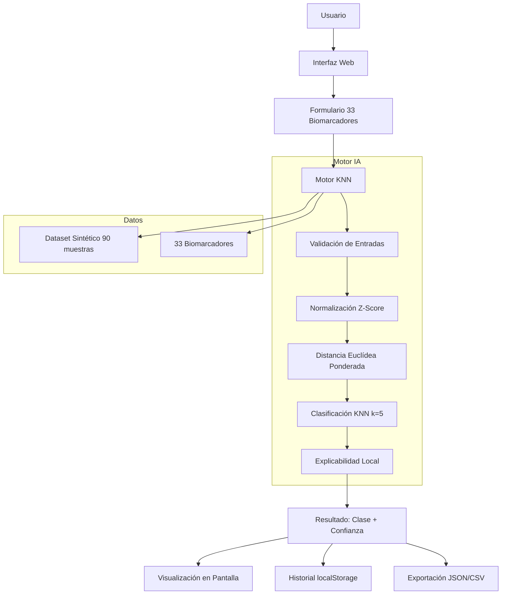
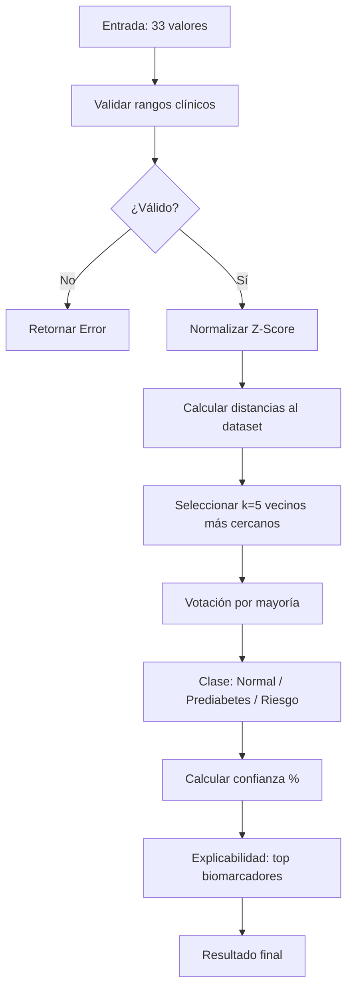
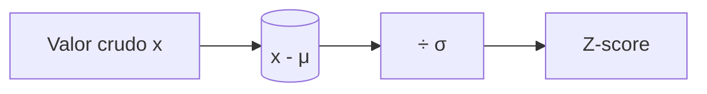
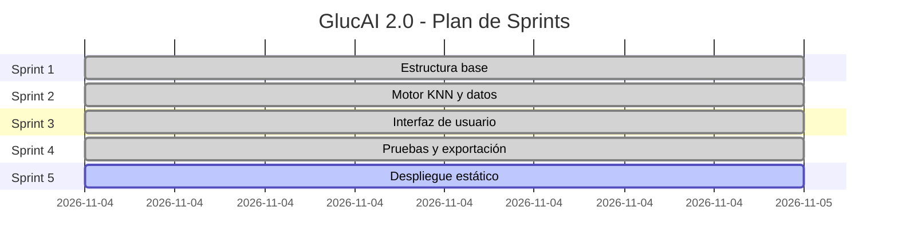

# GlucAI 2.0 — Sistema de Diagnóstico Glucémico con Motor KNN

[]()
[]()
[]()

## 📋 Resumen Ejecutivo

**GlucAI 2.0** es un sistema de diagnóstico glucémico basado en el algoritmo **KNN (k-vecinos más cercanos)** que clasifica perfiles de química sanguínea en tres categorías: **Normal**, **Prediabetes** o **Riesgo glucosa**.

El sistema procesa **33 biomarcadores** de química sanguínea, los normaliza mediante **z-score**, calcula distancias euclídeas ponderadas y devuelve un diagnóstico con nivel de confianza y explicabilidad local (biomarcadores más relevantes).

> ⚠️ **Importante:** Este es un demo educativo con datos sintéticos. No debe usarse para decisiones clínicas reales.

---

## 🏗️ Arquitectura del Sistema



### Capas del sistema

| Capa | Tecnología | Responsabilidad |
|------|-----------|-----------------|
| **Frontend** | HTML5 + ES6 Modules + CSS | Interfaz de usuario, formulario, visualización |
| **Motor IA** | JavaScript puro | Validación, normalización, KNN, explicabilidad |
| **Datos** | JSON estático + localStorage | Dataset sintético, historial de diagnósticos |
| **Despliegue** | Estático (Render/GitHub Pages) | Hosting sin servidor |

---

## 📁 Estructura de Carpetas

```
GlucAI/
├── .github/
│   └── workflows/
│       └── ci.yml
├── docs/
│   ├── arquitectura.md
│   └── manual-usuario.html
├── src/
│   └── frontend/
│       ├── index.html
│       ├── assets/
│       ├── css/
│       │   └── estilos.css
│       └── js/
│           ├── main.js
│           ├── knn/
│           │   ├── indice.js
│           │   ├── validacion.js
│           │   ├── normalizacion.js
│           │   ├── distancia.js
│           │   ├── clasificador.js
│           │   └── explicabilidad.js
│           ├── ui/
│           │   ├── formulario.js
│           │   ├── resultado.js
│           │   └── historial.js
│           └── data/
│               ├── biomarcadores.js
│               └── dataset.js
├── tests/
│   └── _test_knn.mjs
├── .gitignore
├── package.json
└── README.md
```

---

## 🧠 Motor KNN — Flujo de Procesamiento



### Fórmulas clave

**Normalización Z-Score:**


**Distancia Euclídea Ponderada:**
```
d(x, y) = √Σ(wᵢ × (xᵢ - yᵢ)²)
```

**Confianza:**
```
Confianza = (votos de la clase ganadora / k) × 100
```

---

## 🧪 Biomarcadores (33 elementos)

| Categoría | Biomarcadores | Unidad |
|-----------|--------------|--------|
| Glucosa y metabolismo | Glucosa, HbA1c, Insulina | mg/dL, %, uIU/mL |
| Electrolitos | Sodio, Potasio, Cloro, Calcio, Magnesio, Fósforo | mEq/L, mg/dL |
| Función renal | BUN, Creatinina, eGFR | mg/dL, mL/min |
| Función hepática | ALT, AST, ALP, Bilirrubina, GGT | U/L, mg/dL |
| Proteínas | Proteína total, Albúmina | g/dL |
| Lípidos | Colesterol, Triglicéridos, HDL, LDL | mg/dL |
| Inflamación | PCR, Ferritina, Homocisteína | mg/L, ng/mL, µmol/L |
| Endocrino | TSH, T4, Ácido úrico | mIU/L, µg/dL, mg/dL |
| Enzimas musculares | LDH, CPK, Amilasa, Lipasa | U/L |

---

## 🚀 Inicio Rápido

### Opción 1: Abrir demo directamente

```bash
# Clonar el repositorio
git clone https://github.com/gproatechnology/GProA_GlucAI.git
cd GProA_GlucAI

# Abrir en el navegador
# Simplemente abre src/frontend/index.html
```

### Opción 2: Ejecutar pruebas del motor

```bash
node tests/_test_knn.mjs
```

### Opción 3: Desplegar en Render (Static Site)

1. Conecta el repositorio `gproatechnology/GProA_GlucAI` en Render
2. **Publish Directory:** `src/frontend`
3. **Build Command:** (vacío o `echo skip`)
4. **Branch:** `main`

---

## 🗺️ Roadmap por Sprints



| Sprint | Objetivo | Estado |
|--------|----------|--------|
| 1 | Estructura de carpetas, archivos base | ✅ Completado |
| 2 | Motor KNN, validación, normalización, datos | ✅ Completado |
| 3 | Interfaz de usuario, formulario, resultado, historial | ✅ Completado |
| 4 | Pruebas unitarias, exportación CSV/JSON | ✅ Completado |
| 5 | Despliegue estático en Render | 🔄 En progreso |

---

## 🔧 Uso del Motor desde Código

```javascript
import { calcularRiesgoGlucosa } from './src/frontend/js/knn/indice.js';

const resultado = calcularRiesgoGlucosa({
    glucosa: 140,
    hba1c: 6.5,
    insulina: 18,
    // ... los 33 biomarcadores
});

console.log(resultado.clasificacion);   // 'Normal' | 'Prediabetes' | 'Riesgo'
console.log(resultado.confianza);       // 0-100 %
console.log(resultado.notas);           // Texto explicativo
console.log(resultado.explicacion);     // Top biomarcadores relevantes
```

## 📊 Exportación

- **JSON:** Descarga el diagnóstico completo con valores, resultado y fecha
- **CSV:** Descarga tabla con los 33 biomarcadores, clase y confianza

---

## ⚠️ Limitaciones

- Datos sintéticos generados algorítmicamente (no pacientes reales)
- No es un dispositivo médico certificado
- No reemplaza el diagnóstico de un profesional de la salud
- Validación limitada a rangos clínicos generales

---

## 📄 Licencia

MIT License — GProA Technology

---

*Última actualización: Noviembre 2026*
